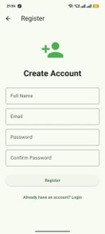
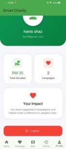

# Smart Charity App

A Flutter-based mobile application developed to make charity campaigns easier to explore and support. The app connects to Firebase services for user authentication and cloud-based campaign and donation data.

> **Academic team project:** This application was developed collaboratively as part of a university Mobile Application Development project. **Shaza Batrisyia** was one of the team members involved in the project. The repository documents the collaborative project and does not assign individual features to specific members.

## Project Overview

Smart Charity provides a mobile interface where users can create an account, sign in, browse charity campaigns, view charity locations on a map, record donation activities, review donation history, and access a profile section.

## Main Features

- **User authentication** — email and password registration, login, and logout using Firebase Authentication.
- **Dashboard** — displays user-related information and donation summaries retrieved from Firestore.
- **Charity campaigns** — retrieves campaign information from Cloud Firestore and provides a campaign detail/donation flow.
- **Donation records** — records donation details in Firestore and updates related campaign and user totals.
- **Donation history** — displays a user's previous donation records.
- **Map view** — displays charity location information using `flutter_map`.
- **User profile** — provides a profile area and logout functionality.
- **Bottom navigation** — provides access to Home, Campaign, Map, History, and Profile sections.

*Note: The donation screen includes payment-method choices in the interface. This repository does not establish that a live payment gateway is integrated.*

## Screenshots

| Login | Register |
|---|---|
|  |  |

| Home screen | Campaign screen |
|---|---|
|  |  |

| Profile |
|---|
|  |

## Technology Stack

| Technology / Package | Usage |
|---|---|
| Flutter | Cross-platform mobile application framework |
| Dart | Application programming language |
| Firebase Core | Firebase initialization |
| Firebase Authentication | Email/password authentication |
| Cloud Firestore | Cloud database for users, campaigns, donations, and charity locations |
| Provider | State-management dependency |
| `flutter_map` and `latlong2` | Map interface and geographic coordinates |
| `image_picker` | Image selection dependency |
| `lottie` | Animation support |
| `audioplayers` | Audio playback |
| `intl` | Date and time formatting |

## Project Structure

```text
smart-charity-app/
├── assets/
│   ├── animations/
│   ├── images/
│   ├── screenshots/
│   └── sounds/
├── lib/
│   ├── models/
│   ├── screens/
│   │   ├── auth/
│   │   ├── home/
│   │   └── map/
│   ├── services/
│   └── main.dart
├── android/
├── ios/
├── macos/
├── web/
├── windows/
├── test/
├── pubspec.yaml
└── README.md
```

## Getting Started

### Requirements

- Flutter SDK (compatible with the Dart SDK constraint in `pubspec.yaml`)
- Dart SDK
- Android Studio or Visual Studio Code
- A Firebase project configured for the platforms you intend to run

### 1. Clone the repository

```bash
git clone <your-repository-url>
cd smart-charity-app
```

### 2. Install dependencies

```bash
flutter pub get
```

### 3. Configure Firebase

Firebase configuration files are intentionally not included in this repository. Connect the project to your own Firebase project before running the app.

1. Create or select a Firebase project in the Firebase Console.
2. Enable **Email/Password** under Authentication sign-in providers.
3. Create a Cloud Firestore database.
4. Configure the required platform apps using the FlutterFire CLI:

```bash
dart pub global activate flutterfire_cli
flutterfire configure
```

This generates the platform configuration, including `lib/firebase_options.dart` used by the app. Follow the Firebase setup instructions for Android and any other target platform. Do not commit private service-account credentials or signing keys.

### 4. Run the application

Connect an emulator or device, then run:

```bash
flutter run
```

## Learning Outcomes

This team project provided practical experience with:

- Building a mobile application using Flutter and Dart.
- Creating registration and login flows with Firebase Authentication.
- Reading and writing application data with Cloud Firestore.
- Organizing an application into screens, models, and service classes.
- Working with map and location-related UI components.
- Collaborating on a university mobile application project.

## Project Contributors

Developed collaboratively as a university team project.

- **Shaza Batrisyia** — team member.

Individual task allocations are not listed.

---

**Project type:** University Academic Team Project  
**Domain:** Charity and Donation  
**Framework:** Flutter
